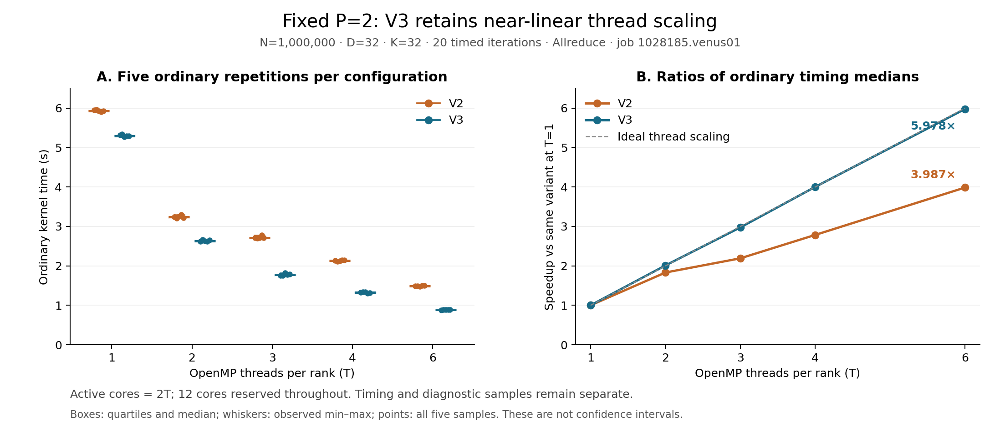
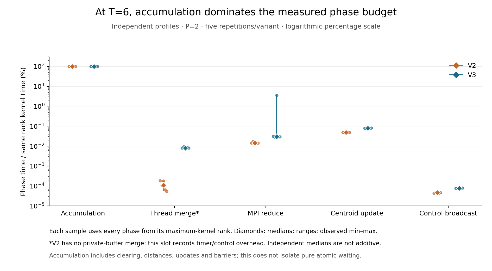

# 固定 P=2 线程扩展：已核查结果

2026-10-27 整理；作业 `1028185.venus01`，主机 `cnode-33-43-32`。

## 结果

固定 P=2、T=1/2/3/4/6，对比 V2（atomic）和 V3（线程私有缓冲再合并），通信固定为 Allreduce。N=1,000,000、D=32、K=32、seed=42；20 轮计时、2 轮预热、每配置 5 次重复。

| T | Active cores (2T) | V2 median / s | V3 median / s | V2 speedup | V3 speedup |
|---:|---:|---:|---:|---:|---:|
| 1 | 2 | 5.932525 | 5.298626 | 1.000 | 1.000 |
| 2 | 4 | 3.239149 | 2.635595 | 1.832 | 2.010 |
| 3 | 6 | 2.706680 | 1.780568 | 2.192 | 2.976 |
| 4 | 8 | 2.130149 | 1.323602 | 2.785 | 4.003 |
| 6 | 12 | 1.488148 | 0.886366 | 3.987 | 5.978 |

加速比各自相对同一实现的 P=2、T=1 中位数，因此不是相对串行 V0 的总加速比。T=6 时 V3 比 V2 快 1.679 倍，内核时间低 40.44%；V3 线程效率为 99.63%，V2 为 66.44%。个别效率略高于 100% 是有限重复下的观测值，不证明稳定超线性扩展。



箱线图显示每配置 5 个原始观测，须线为实测最小–最大值，点为全部样本。图中加速比为中位数之比；范围和离散程度均不是置信区间。

## 阶段诊断



独立诊断不混入普通性能样本。每条 profile 使用**同一次测量中内核最慢 rank 的所有阶段**，不对跨 rank 的阶段最大值求和。T=6 时，accumulate 占比中位数 V2 为 99.9349%，V3 为 99.8783%；V3 的合并时间中位数为 72.898 微秒（20 轮合计），占比中位数 0.008162%。当前规模下合并开销很小。

accumulate 包含清零、距离计算、更新和 OpenMP 屏障，MPI reduce 也可能包含等待。因此这些结果支持 V3 在本工作负载上扩展更好，不能直接把 V2/V3 差值解释为纯 atomic 等待。V2 的 thread_merge 槽主要为计时控制开销，没有 V3 式私有缓冲合并。百分比先逐样本计算再取中位数；独立阶段中位数之和无需等于 100% 或内核时间中位数。这里只显示单个作业的观测，不与旧作业拼为同一次受控比较。

## 资源与复核

- 12 核整作业保留，活动核数为 2T。rank 0 固定保留 OS CPU 24–29，rank 1 为 30–35；本次全部位于客体系统报告的 socket 0、NUMA 1，**不是一 rank 一 socket**。
- `lscpu` 报告 AMD EPYC 7R13、KVM、96 个逻辑 CPU、2 socket、4 NUMA。这是客体可见拓扑，不能推断底层裸机物理核心分配。
- GCC 9.2.0、Open MPI 4.1.2、远端 Python 3.8.5；准确的源码包及 29 个源文件校验项均匹配。
- 50 条普通测量、50 条诊断、20 次预检均通过完整性、数值、逐 rank/线程绑核复核。最大 SSE 绝对误差为 6.78003e-6（相对 V0，SSE 约 7.344e7），簇计数完全一致。
- 原四组 125 条测量已重新复核，所有原始运行文件与源码包逐字节保持不变；目录清单与说明已按合并结构更新。现在是 **175 条普通性能测量 + 50 条独立诊断**，预检及 pilot 另外保存。
- 新增材料已并入统一 `benchmarks/atlas` 清单（当前统一归档为 1820 个校验文件）；原始记录保持逐字节一致。两张 CSV 及三语言分析正文与远端逐字节一致；重算审计仅增加退出脚本随后创建的 status.txt 哈希。
- 尚缺 `pbs-job.txt`、`p3_tscale.o1028185`，退出 0 依据作业内状态文件；不宣称已独立核对调度器退出记录。可执行文件未下载，只保留远端二进制哈希及测量关联。

## 文件与复现

- [精确普通计时 CSV](thread-scaling-summary.csv)、[精确阶段 CSV](thread-scaling-phase-summary.csv)、[本地复核摘要](thread-scaling-local-review.json)。
- 完整英文分析 [analysis.md](thread-scaling-results.en.md)、中文 [analysis.zh-CN.md](thread-scaling-results.zh-CN.md)、韩文 [analysis.ko.md](thread-scaling-results.ko.md)。
- [原始证据](../../benchmarks/atlas/EXPERIMENT_INDEX.zh-CN.md)及确切提交源码包与其他四组一起归档，下载原目录也保留。
- 图源 `../../scripts/plot_atlas_thread_scaling.py`；图表另存 SVG。运行需 Code/requirements.txt 中的 Matplotlib。
- 报告可直接采用的英文补充稿见 [Thread_Scaling_Addendum_20261027.md](../../../Report/Thread_Scaling_Addendum_20261027.md)。旧 PDF/旧交付包未包含本实验，未覆盖。

在 Code 根目录复核：

```sh
python3 -B scripts/reproduce_atlas.py --verify-only
python3 -B scripts/reproduce_atlas_thread_scaling.py --output artifacts/thread-scaling-recheck-new
python3 scripts/plot_atlas_thread_scaling.py
```

第二条命令使用冻结提交包中的分析程序，在新目录重算；若输出目录已存在，改用新的目录名。
