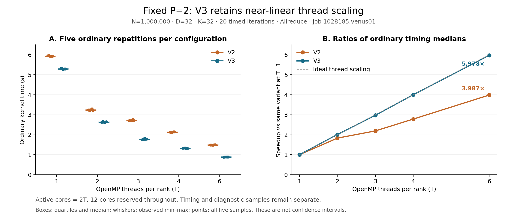
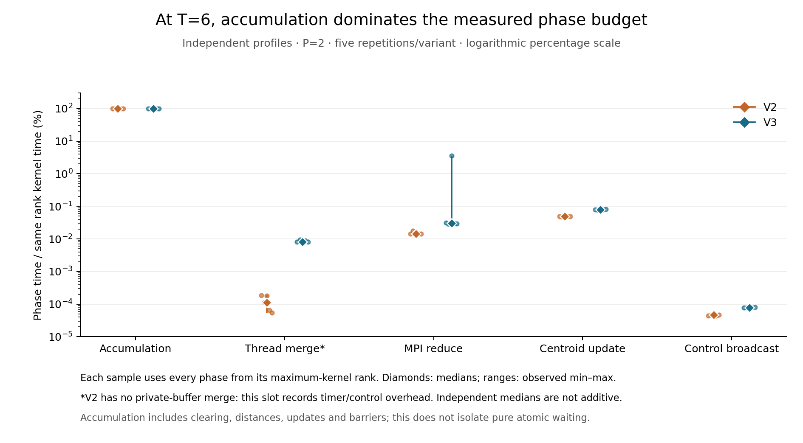
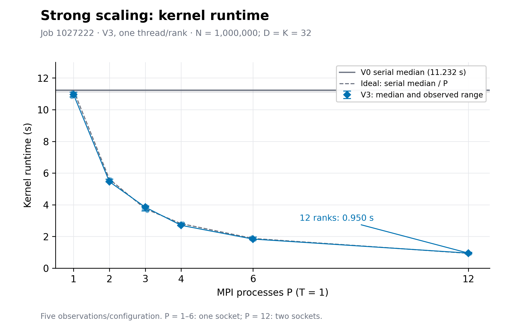
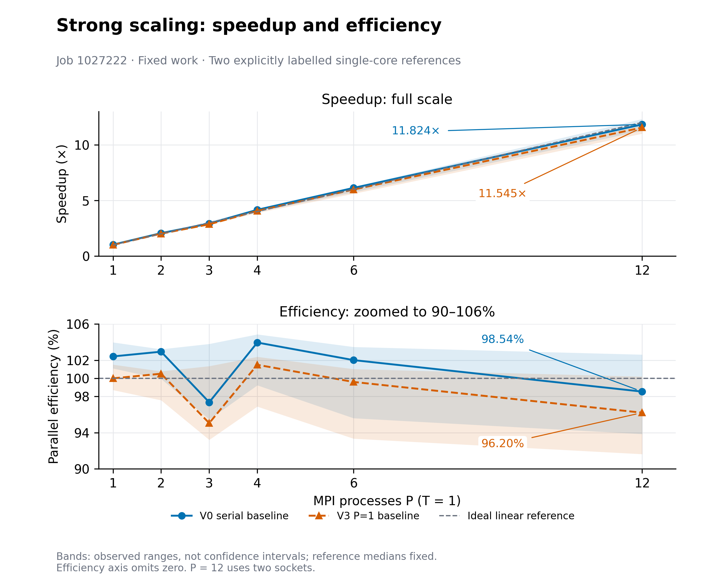
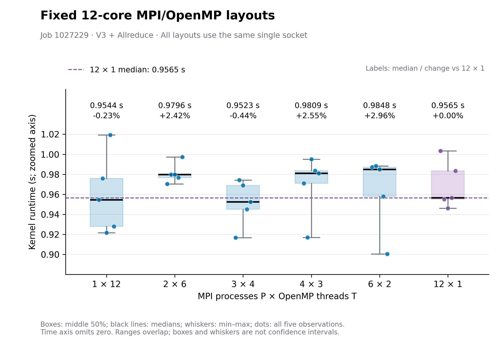
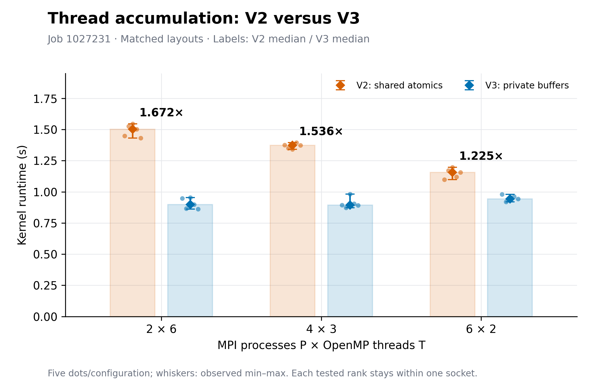
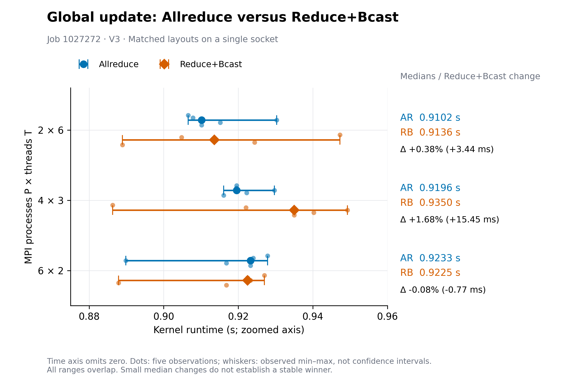

# Atlas results for the report

[English](report_results.en.md) | [简体中文](report_results.zh-CN.md) | [한국어](report_results.ko.md)

**175 ordinary measurements; 50 separate diagnostic profiles.**

All figures use the recorded synthetic workload: N=1,000,000, D=32, K=32, seed=42; 20 measured iterations after 2 warmup iterations, 5 repeats per configuration. The plotted metric is `kernel_seconds`, excluding data preparation, initialization, warmup/reset, final evaluation and external launch/probe overhead. Each comparison stays within its own job. Whiskers and bands describe observed ranges, not confidence intervals.

## Results and interpretation

The V0 serial median was 11.232365 s, compared with 0.949930 s for V3 at 12 MPI ranks. This gives 11.824x speedup and 98.54% efficiency relative to V0; the alternate V3 P=1 baseline gives 11.545x and 96.20%. Some points exceed the ideal linear reference slightly. These observations do not establish general superlinear scaling: there are only five repeats, the implementations differ, and P=12 uses a second socket.

Fixed 12-core layout medians ranged from 0.952300 to 0.984793 s. The observed ranges overlap, so no stable best layout is established.

V3 was faster than V2 at every tested layout: median runtime reductions ranged from 18.33% to 40.20%. All observed V3 times were below all observed V2 times within each matched layout. This supports the private-buffer design for this workload; it does not quantify atomic-wait or memory-bandwidth costs without profiling.

Reduce+Bcast median time changes relative to Allreduce ranged from -0.08% to +1.68%. Observed ranges overlap for every layout, and the direction varies. No stable communication-strategy winner is established.

### Fixed P=2 thread scaling

At T=6, V2/V3 thread speedups are 3.987/5.978, with efficiencies 66.44%/99.63%. Each baseline is the same variant at P=2,T=1; efficiency divides by T, not 2T. Fifty ordinary timings and fifty independent profiles are kept separate. Profiles use every phase of the same maximum-kernel rank; accumulation includes distances and barriers, so this is not pure atomic waiting.

[Details](THREAD_SCALING.md) · [Timing CSV](thread-scaling-summary.csv) · [Phase CSV](thread-scaling-phase-summary.csv)

## Figure captions

### Strong scaling: kernel runtime

V3 runtime with one OpenMP thread per MPI rank. Dots show five V3 observations at each process count; markers and whiskers show their median and observed minimum/maximum. The V0 single-core median is the horizontal reference, with its observed range shaded. P=1–6 uses one socket; P=12 uses two sockets. The dashed ideal curve is V0 median / P.

### Strong scaling: speedup and efficiency

Top: speedup on its full scale. Bottom: efficiency zoomed to 90–106% so departures from ideal scaling and the two reference choices are visible. Zero is omitted only in the efficiency panel. Speedup uses either the V0 serial median or the explicitly labelled V3 P=1 median; efficiency is speedup / P. Shaded bands use observed parallel ranges with reference medians fixed, not confidence intervals. Socket placement changes at P=12.

### Fixed 12-core MPI/OpenMP layouts

Six V3 layouts use the same allocated 12 cores on one socket. Boxes span the first to third quartile; black lines mark medians, whiskers span the observed minimum/maximum, and dots retain all five observations. The vertical time axis is explicitly zoomed and omits zero. Labels give median runtimes and percentage changes relative to the 12x1 median (horizontal dashed line). Ranges overlap; boxes and whiskers are not confidence intervals. This is a fixed-resource comparison, not strong-scaling efficiency.

### Thread accumulation: V2 versus V3

V2 shared atomic accumulation and V3 thread-private buffers use matched layouts within the same job. Dots show five observations per configuration; whiskers show their observed range. Labels above pairs give the ratio of V2 and V3 medians. The job spans two sockets, but each tested rank stays within one socket. No phase profiling was performed.

### Global update: Allreduce versus Reduce+Bcast

V3 Allreduce and Reduce+Bcast use matched layouts on one socket. The horizontal time axis is explicitly zoomed and omits zero. Each strategy retains all five observations and its complete observed min/max range; circles/diamonds mark medians. The right column prints both medians and Reduce+Bcast minus Allreduce changes in percent and milliseconds. Ranges overlap at every layout, so the small median differences do not establish a stable winner. These are whole-kernel timings, not isolated collective costs.

## Tables

### Strong scaling

| Variant | P | T | Collective | Median (s) | Observed min–max (s) |
|---|---:|---:|---|---:|---:|
| v0 | 1 | 1 | none (serial) | 11.232365 | 11.083708–11.268552 |
| v3 | 1 | 1 | allreduce | 10.966528 | 10.801994–11.109828 |
| v3 | 2 | 1 | allreduce | 5.455342 | 5.440761–5.619235 |
| v3 | 3 | 1 | allreduce | 3.845761 | 3.606678–3.922051 |
| v3 | 4 | 1 | allreduce | 2.701160 | 2.677779–2.829734 |
| v3 | 6 | 1 | allreduce | 1.835040 | 1.809149–1.958218 |
| v3 | 12 | 1 | allreduce | 0.949930 | 0.912044–0.997377 |

### Hybrid layouts

| Variant | P | T | Collective | Median (s) | Observed min–max (s) |
|---|---:|---:|---|---:|---:|
| v3 | 1 | 12 | allreduce | 0.954366 | 0.921613–1.019229 |
| v3 | 2 | 6 | allreduce | 0.979631 | 0.970431–0.997293 |
| v3 | 3 | 4 | allreduce | 0.952300 | 0.916632–0.974131 |
| v3 | 4 | 3 | allreduce | 0.980928 | 0.916852–0.994980 |
| v3 | 6 | 2 | allreduce | 0.984793 | 0.900327–0.988295 |
| v3 | 12 | 1 | allreduce | 0.956526 | 0.946156–1.003424 |

### Thread strategies

| Variant | P | T | Collective | Median (s) | Observed min–max (s) |
|---|---:|---:|---|---:|---:|
| v2 | 2 | 6 | allreduce | 1.501355 | 1.431110–1.544514 |
| v2 | 4 | 3 | allreduce | 1.373188 | 1.340761–1.394033 |
| v2 | 6 | 2 | allreduce | 1.155894 | 1.097906–1.196416 |
| v3 | 2 | 6 | allreduce | 0.897849 | 0.862031–0.954998 |
| v3 | 4 | 3 | allreduce | 0.893993 | 0.872011–0.981837 |
| v3 | 6 | 2 | allreduce | 0.943962 | 0.920078–0.980020 |

### Communication strategies

| Variant | P | T | Collective | Median (s) | Observed min–max (s) |
|---|---:|---:|---|---:|---:|
| v3 | 2 | 6 | allreduce | 0.910166 | 0.906586–0.930287 |
| v3 | 2 | 6 | reduce-bcast | 0.913610 | 0.888920–0.947241 |
| v3 | 4 | 3 | allreduce | 0.919556 | 0.916105–0.929694 |
| v3 | 4 | 3 | reduce-bcast | 0.935007 | 0.886339–0.949262 |
| v3 | 6 | 2 | allreduce | 0.923267 | 0.889835–0.927843 |
| v3 | 6 | 2 | reduce-bcast | 0.922502 | 0.887874–0.927026 |

### Fixed P=2 thread scaling

| Variant | P | T | Collective | Median (s) | Observed min–max (s) |
|---|---:|---:|---|---:|---:|
| v2 | 2 | 1 | allreduce | 5.932525 | 5.899510–5.961822 |
| v2 | 2 | 2 | allreduce | 3.239149 | 3.204542–3.299726 |
| v2 | 2 | 3 | allreduce | 2.706680 | 2.705456–2.786131 |
| v2 | 2 | 4 | allreduce | 2.130149 | 2.114199–2.151687 |
| v2 | 2 | 6 | allreduce | 1.488148 | 1.479371–1.503290 |
| v3 | 2 | 1 | allreduce | 5.298626 | 5.265328–5.338572 |
| v3 | 2 | 2 | allreduce | 2.635595 | 2.622310–2.664717 |
| v3 | 2 | 3 | allreduce | 1.780568 | 1.749308–1.819223 |
| v3 | 2 | 4 | allreduce | 1.323602 | 1.310441–1.343187 |
| v3 | 2 | 6 | allreduce | 0.886366 | 0.875813–0.888638 |

