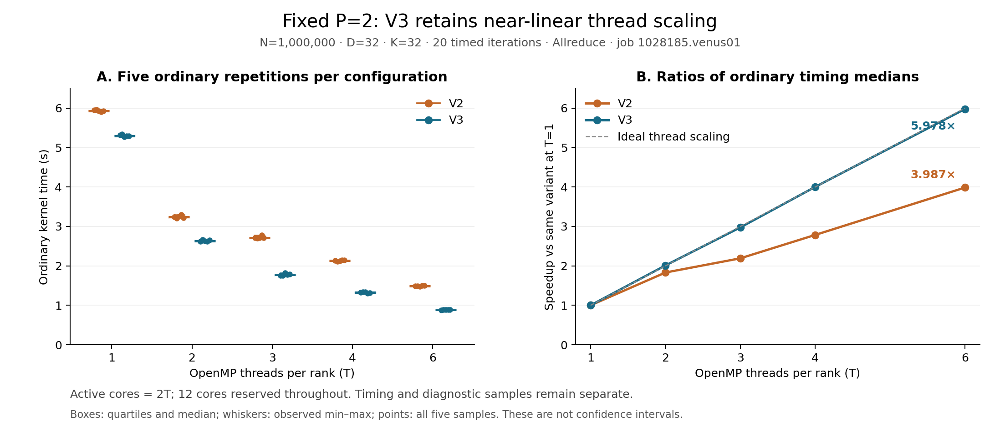
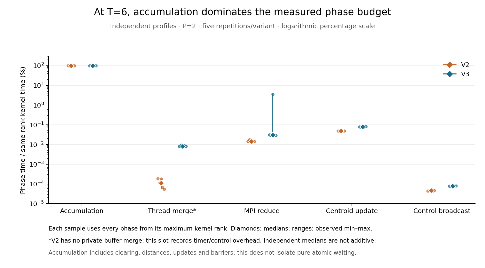
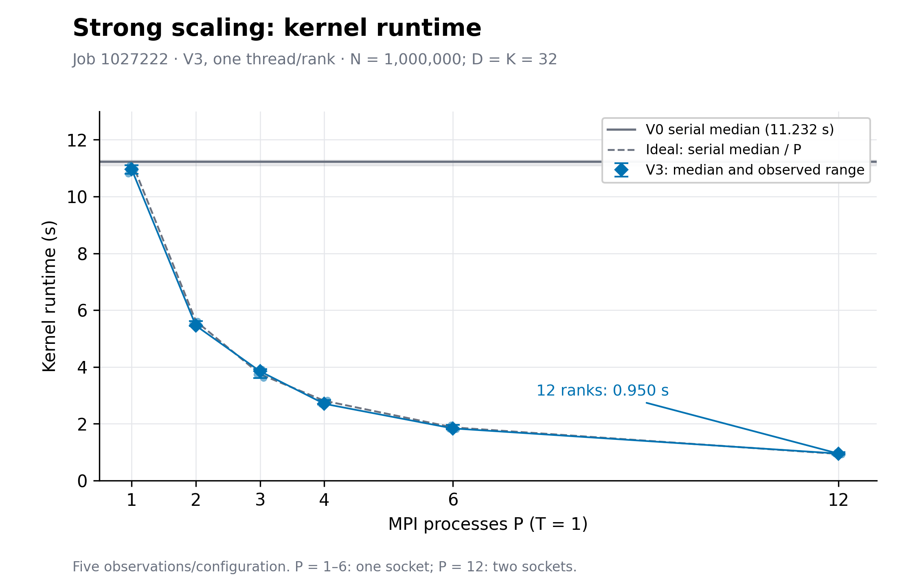
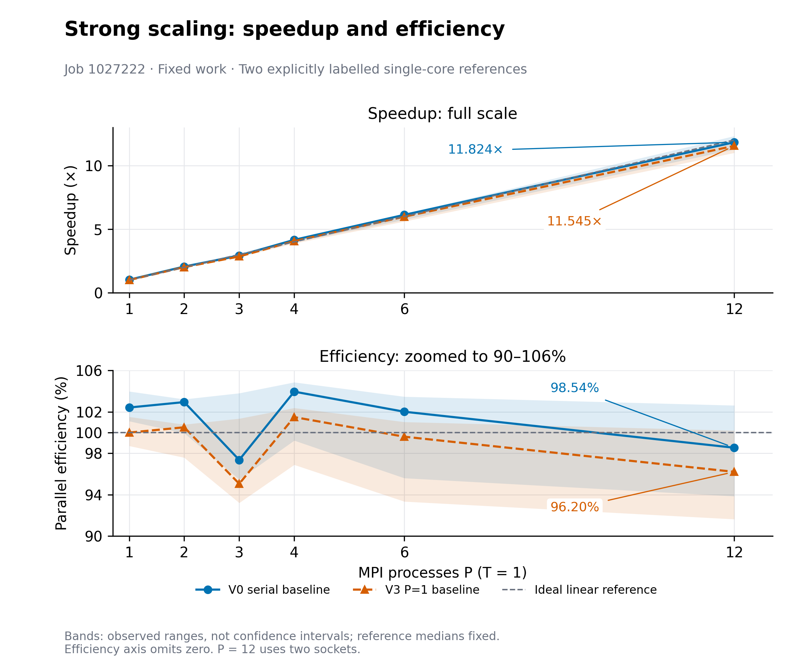
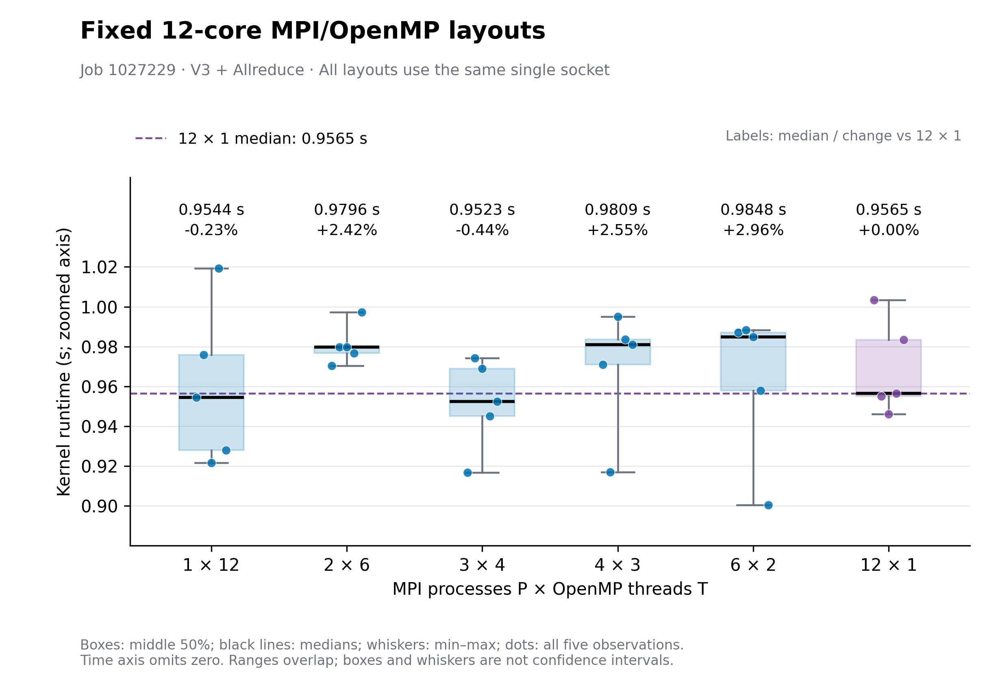
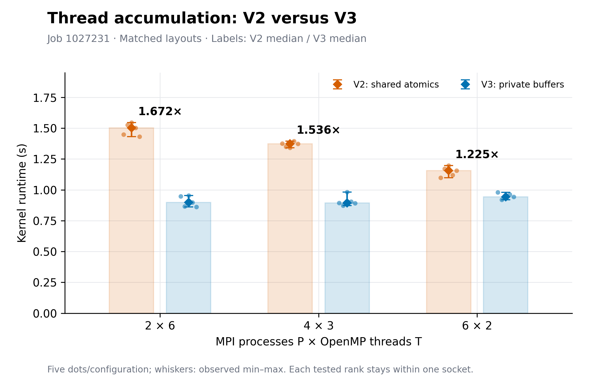
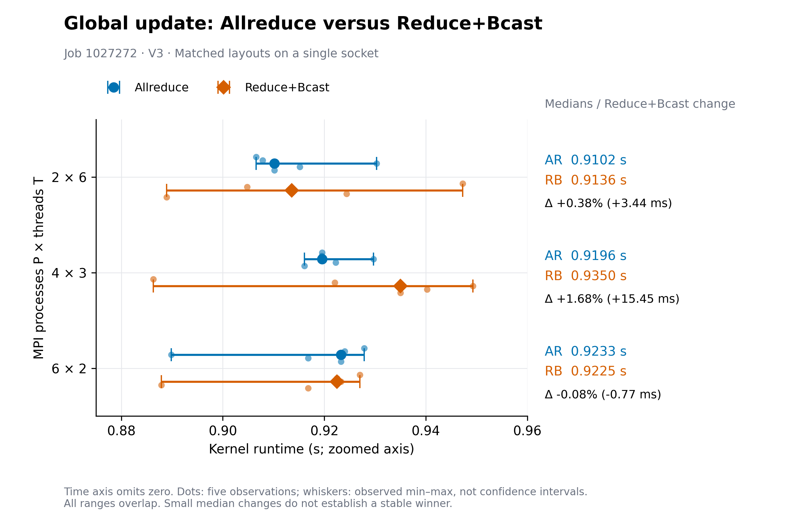

# 보고서용 Atlas 실험 결과

**175 ordinary measurements; 50 separate diagnostic profiles.**

모든 그림은 기록된 합성 작업 부하 N=1,000,000, D=32, K=32, seed=42를 사용합니다. 준비 반복 2회 후 20회를 측정하며, 구성마다 5회 반복 실행합니다. 표시 지표는 `kernel_seconds`로, 데이터 준비, 초기화, 준비 반복/초기 상태 복원, 최종 평가 및 외부 실행/바인딩 탐침의 비용은 제외합니다. 모든 비교는 동일 작업 내에서만 수행합니다. 수염과 음영은 관측 범위이며 신뢰구간이 아닙니다.

## 결과와 해석

V0 직렬 실행의 중앙값은 11.232365 s이며, MPI 프로세스 12개를 사용한 V3는 0.949930 s입니다. V0 대비 속도 향상은 11.824배, 효율은 98.54%입니다. 별도로 표시한 V3 P=1 기준에서는 11.545배와 96.20%입니다. 일부 점이 이상적인 선형 기준을 약간 넘지만, 반복이 5회뿐이고 구현이 다르며 P=12에서는 두 번째 소켓을 사용하므로 일반적인 초선형 확장성을 입증하지 않습니다.

12코어 고정 배치의 중앙 실행 시간은 0.952300–0.984793 s입니다. 관측 범위가 겹치므로 일관되게 가장 좋은 배치를 확정할 수 없습니다.

측정한 모든 배치에서 V3가 V2보다 빨랐으며 중앙 실행 시간은 18.33%–40.20% 감소했습니다. 동일 배치에서 모든 V3 관측값이 모든 V2 관측값보다 작았습니다. 이는 이 작업 부하에서 전용 버퍼 설계를 뒷받침하지만, 단계별 프로파일 없이 원자 연산 대기나 메모리 대역폭 비용을 정량화할 수는 없습니다.

Allreduce 대비 Reduce+Bcast의 중앙 실행 시간 변화는 -0.08%–+1.68%입니다. 모든 배치에서 관측 범위가 겹치고 변화 방향도 다르므로 일관되게 우수한 통신 전략을 확정할 수 없습니다.

### 고정 P=2 스레드 확장

T=6에서 V2/V3 스레드 가속비는 3.987/5.978이고 효율은 66.44%/99.63%이다. 각 기준은 같은 구현의 P=2,T=1이며 효율은 2T가 아닌 T로 나눈다. 일반 측정 50개와 별도 진단 50개를 구분한다. 진단은 같은 최대 커널 시간 rank의 모든 단계를 사용한다. accumulate에는 거리 계산과 장벽이 포함되어 순수 atomic 대기로 해석할 수 없다.

[Details](THREAD_SCALING.ko.md) · [Timing CSV](thread-scaling-summary.csv) · [Phase CSV](thread-scaling-phase-summary.csv)

## 그림 설명

### 강한 확장성: 커널 실행 시간

MPI 프로세스마다 OpenMP 스레드 1개를 사용하는 V3 실행 시간입니다. 점은 각 프로세스 수에서의 V3 관측 5개이며, 표식과 수염은 중앙값 및 관측 최솟값/최댓값입니다. V0 단일 코어 중앙값은 수평 기준선이고 그 관측 범위는 음영으로 표시합니다. P=1–6은 소켓 1개, P=12는 소켓 2개를 사용합니다. 이상적인 점선은 V0 중앙 실행 시간 / P입니다.

### 강한 확장성: 속도 향상과 효율

위: 전체 범위의 속도 향상. 아래: 이상적인 확장성과의 차이 및 두 기준의 차이를 볼 수 있도록 효율 축을 90–106%로 확대합니다. 영점은 효율 패널에서만 생략합니다. 속도 향상은 V0 직렬 중앙값 또는 명시한 V3 P=1 중앙값을 사용하며 효율은 속도 향상 / P입니다. 음영은 기준 중앙값을 고정한 관측 병렬 범위로, 신뢰구간이 아닙니다. P=12에서 소켓 배치가 바뀝니다.

### 12코어 고정 MPI/OpenMP 배치

V3 배치 6개는 동일 소켓에 할당된 12코어를 사용합니다. 상자는 제1사분위수부터 제3사분위수까지, 검은 선은 중앙값, 수염은 관측 최솟값/최댓값이며 점은 관측 5개를 모두 표시합니다. 세로 시간 축은 명시적으로 확대되어 영점을 생략합니다. 레이블은 중앙 실행 시간과 12x1 중앙값(수평 점선) 대비 변화율입니다. 범위가 겹치며 상자와 수염은 신뢰구간이 아닙니다. 이는 자원 고정 비교로, 강한 확장성 효율이 아닙니다.

### 스레드 누적: V2와 V3

V2 공유 원자적 누적과 V3 스레드 전용 버퍼는 같은 작업에서 동일한 배치를 사용합니다. 점은 구성별 관측 5개, 수염은 관측 범위입니다. 각 쌍 위의 레이블은 V2/V3 중앙 실행 시간 비율입니다. 작업은 소켓 2개에 걸치지만 측정한 각 프로세스는 소켓 1개 안에 머뭅니다. 단계별 프로파일은 수행하지 않았습니다.

### 전역 갱신: Allreduce와 Reduce+Bcast

V3 Allreduce와 Reduce+Bcast는 소켓 1개에서 동일한 배치를 사용합니다. 가로 시간 축은 명시적으로 확대되어 영점을 생략합니다. 각 전략의 관측 5개와 전체 최솟값/최댓값 범위를 유지하며 원/마름모는 중앙값입니다. 오른쪽에는 두 중앙값 및 Reduce+Bcast에서 Allreduce를 뺀 백분율/밀리초 변화가 표시됩니다. 모든 배치의 범위가 겹치므로 작은 중앙값 차이로 일관된 우열을 확정할 수 없습니다. 개별 집단 통신 비용이 아닌 전체 커널 실행 시간입니다.

## 통계표

### 강한 확장성

| 버전 | P | T | 집단 통신 | 중앙값 (s) | 관측 최솟값–최댓값 (s) |
|---|---:|---:|---|---:|---:|
| v0 | 1 | 1 | 없음(직렬) | 11.232365 | 11.083708–11.268552 |
| v3 | 1 | 1 | allreduce | 10.966528 | 10.801994–11.109828 |
| v3 | 2 | 1 | allreduce | 5.455342 | 5.440761–5.619235 |
| v3 | 3 | 1 | allreduce | 3.845761 | 3.606678–3.922051 |
| v3 | 4 | 1 | allreduce | 2.701160 | 2.677779–2.829734 |
| v3 | 6 | 1 | allreduce | 1.835040 | 1.809149–1.958218 |
| v3 | 12 | 1 | allreduce | 0.949930 | 0.912044–0.997377 |

### 하이브리드 배치

| 버전 | P | T | 집단 통신 | 중앙값 (s) | 관측 최솟값–최댓값 (s) |
|---|---:|---:|---|---:|---:|
| v3 | 1 | 12 | allreduce | 0.954366 | 0.921613–1.019229 |
| v3 | 2 | 6 | allreduce | 0.979631 | 0.970431–0.997293 |
| v3 | 3 | 4 | allreduce | 0.952300 | 0.916632–0.974131 |
| v3 | 4 | 3 | allreduce | 0.980928 | 0.916852–0.994980 |
| v3 | 6 | 2 | allreduce | 0.984793 | 0.900327–0.988295 |
| v3 | 12 | 1 | allreduce | 0.956526 | 0.946156–1.003424 |

### 스레드 전략

| 버전 | P | T | 집단 통신 | 중앙값 (s) | 관측 최솟값–최댓값 (s) |
|---|---:|---:|---|---:|---:|
| v2 | 2 | 6 | allreduce | 1.501355 | 1.431110–1.544514 |
| v2 | 4 | 3 | allreduce | 1.373188 | 1.340761–1.394033 |
| v2 | 6 | 2 | allreduce | 1.155894 | 1.097906–1.196416 |
| v3 | 2 | 6 | allreduce | 0.897849 | 0.862031–0.954998 |
| v3 | 4 | 3 | allreduce | 0.893993 | 0.872011–0.981837 |
| v3 | 6 | 2 | allreduce | 0.943962 | 0.920078–0.980020 |

### 통신 전략

| 버전 | P | T | 집단 통신 | 중앙값 (s) | 관측 최솟값–최댓값 (s) |
|---|---:|---:|---|---:|---:|
| v3 | 2 | 6 | allreduce | 0.910166 | 0.906586–0.930287 |
| v3 | 2 | 6 | reduce-bcast | 0.913610 | 0.888920–0.947241 |
| v3 | 4 | 3 | allreduce | 0.919556 | 0.916105–0.929694 |
| v3 | 4 | 3 | reduce-bcast | 0.935007 | 0.886339–0.949262 |
| v3 | 6 | 2 | allreduce | 0.923267 | 0.889835–0.927843 |
| v3 | 6 | 2 | reduce-bcast | 0.922502 | 0.887874–0.927026 |

### 고정 P=2 스레드 확장

| 버전 | P | T | 집단 통신 | 중앙값 (s) | 관측 최솟값–최댓값 (s) |
|---|---:|---:|---|---:|---:|
| v2 | 2 | 1 | allreduce | 5.932525 | 5.899510–5.961822 |
| v2 | 2 | 2 | allreduce | 3.239149 | 3.204542–3.299726 |
| v2 | 2 | 3 | allreduce | 2.706680 | 2.705456–2.786131 |
| v2 | 2 | 4 | allreduce | 2.130149 | 2.114199–2.151687 |
| v2 | 2 | 6 | allreduce | 1.488148 | 1.479371–1.503290 |
| v3 | 2 | 1 | allreduce | 5.298626 | 5.265328–5.338572 |
| v3 | 2 | 2 | allreduce | 2.635595 | 2.622310–2.664717 |
| v3 | 2 | 3 | allreduce | 1.780568 | 1.749308–1.819223 |
| v3 | 2 | 4 | allreduce | 1.323602 | 1.310441–1.343187 |
| v3 | 2 | 6 | allreduce | 0.886366 | 0.875813–0.888638 |

