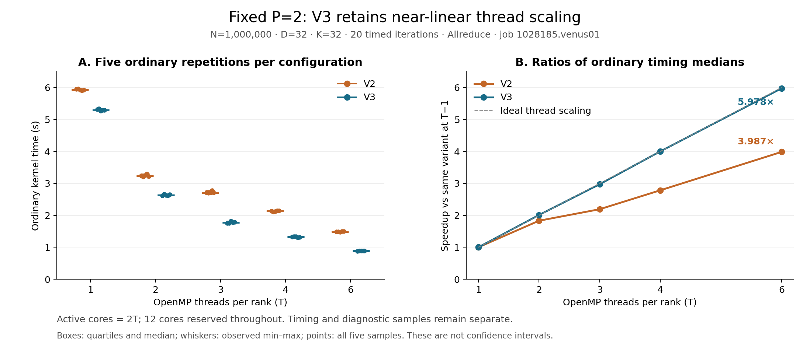
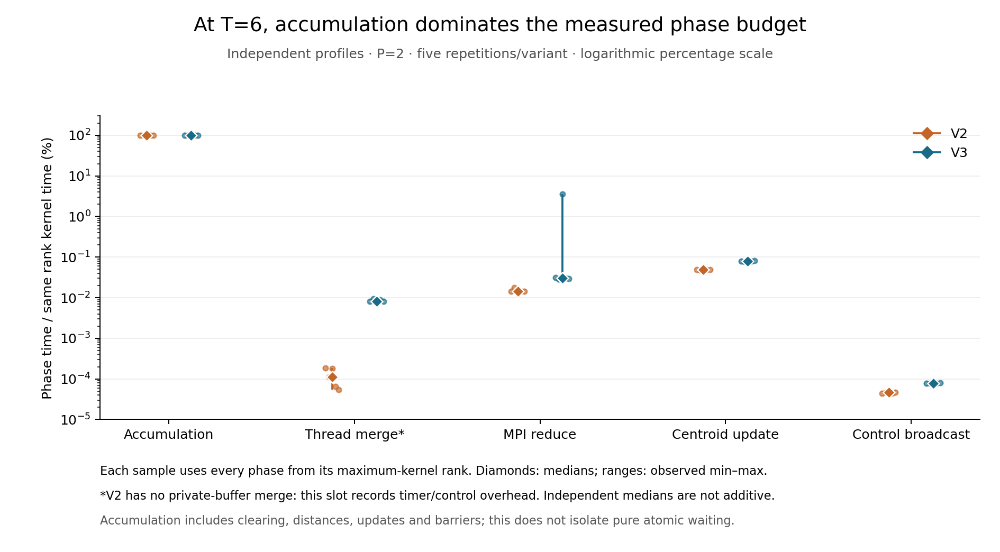
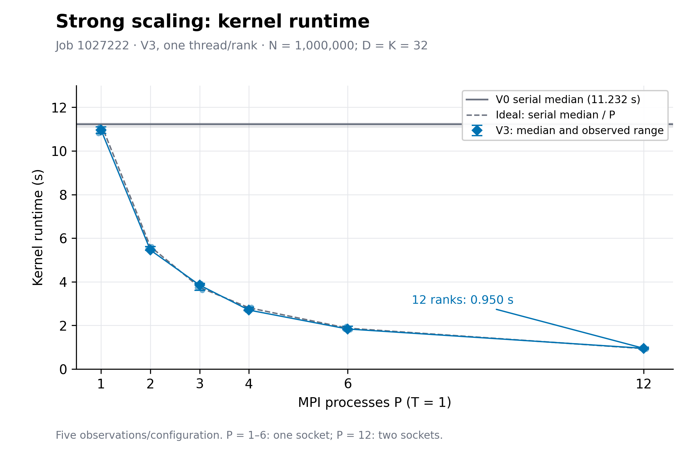
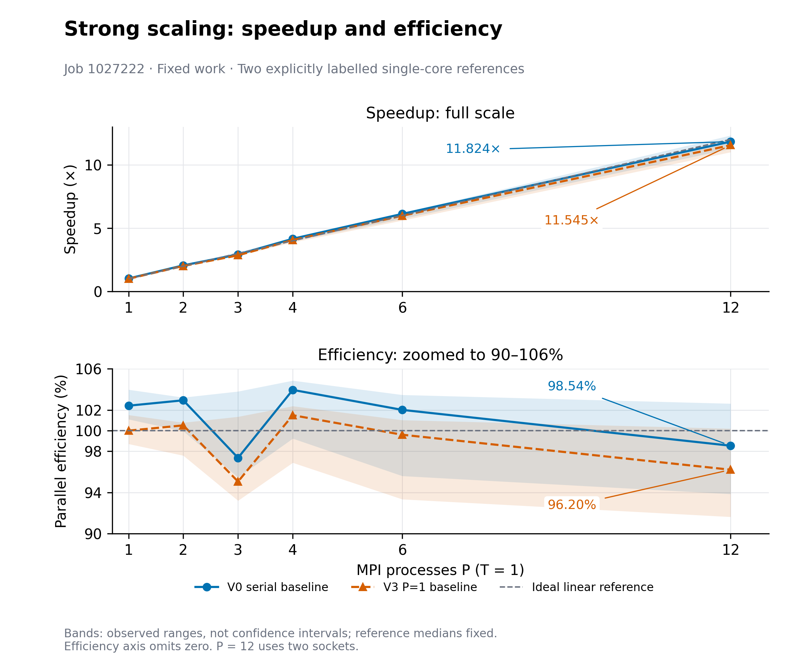
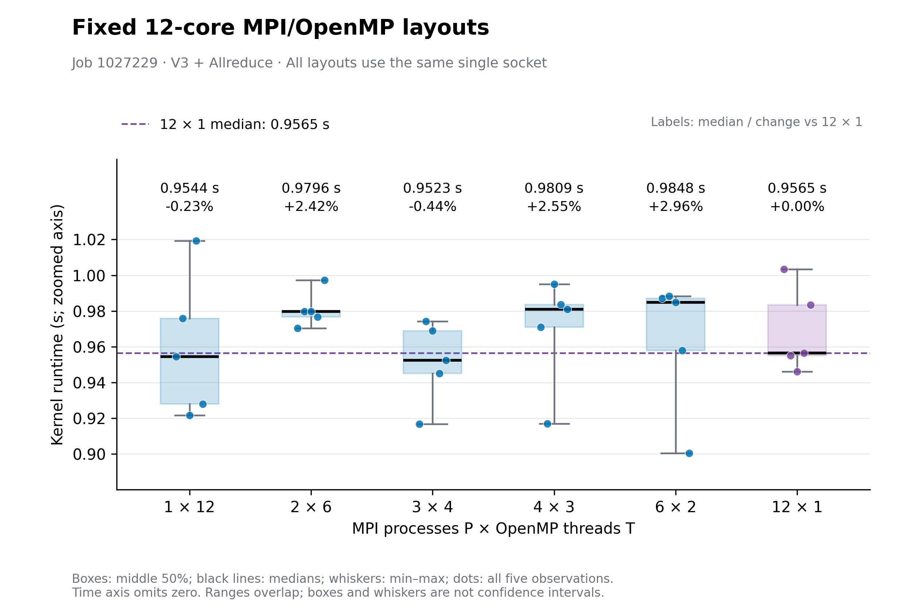
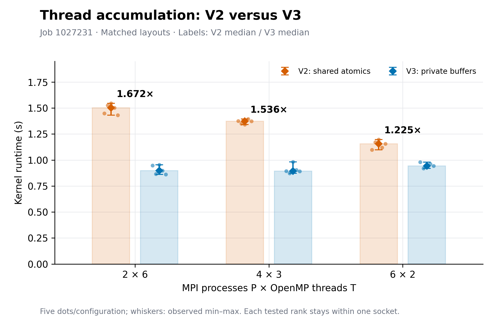
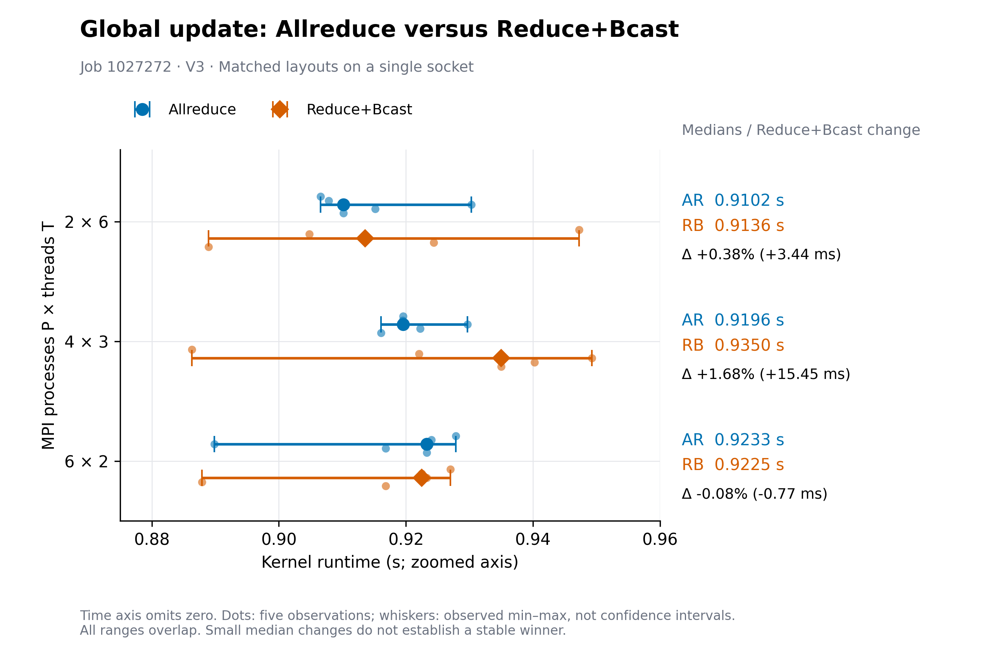

# 报告所用 Atlas 实验结果

**175 ordinary measurements; 50 separate diagnostic profiles.**

所有图均使用已记录的合成工作负载：N=1,000,000、D=32、K=32、seed=42；2 轮预热后计时 20 轮，每配置重复 5 次。图中指标为 `kernel_seconds`，不含数据准备、初始化、预热/重置、最终评估及外部启动/绑核探针开销。所有比较均限于同一作业。须线和色带表示实测范围，不是置信区间。

## 结果与解释

V0 串行中位耗时为 11.232365 s，V3 在 12 个 MPI 进程时为 0.949930 s。相对 V0 的加速比为 11.824 倍、效率为 98.54%；相对另一条明确标注的 V3 P=1 基线，则为 11.545 倍和 96.20%。部分点略高于理想线性参考，但只有五次重复，且实现不同、P=12 使用第二个 socket，不能据此认定普遍存在超线性扩展。

固定 12 核配比的中位耗时为 0.952300–0.984793 s。实测范围重叠，不能认定稳定最优配比。

在全部所测配比中 V3 均快于 V2，中位耗时下降 18.33%–40.20%。每个匹配配比的全部 V3 观测都低于全部 V2 观测。这支持在本工作负载中使用私有缓冲；缺少阶段 profile，不能定量归因为原子等待或内存带宽成本。

Reduce+Bcast 相对 Allreduce 的中位耗时变化为 -0.08%–+1.68%。每种配比的实测范围均重叠，变化方向也不一致，没有稳定的通信策略胜者。

### 固定 P=2 线程扩展

T=6 时 V2/V3 的线程加速比为 3.987/5.978，效率为 66.44%/99.63%。各自基线为同一实现的 P=2、T=1；线程效率除以 T，不是 2T。50 条普通计时与 50 条独立诊断分别保存。诊断使用同次测量内核最慢 rank 的全部阶段，accumulate 含距离计算与屏障，不能直接解释为纯 atomic 等待。

[Details](THREAD_SCALING.zh-CN.md) · [Timing CSV](thread-scaling-summary.csv) · [Phase CSV](thread-scaling-phase-summary.csv)

## 图注

### 强扩展：内核耗时

V3 每个 MPI 进程使用一个 OpenMP 线程。散点为各进程数下的五次 V3 观测；标记和须线表示中位数及实测最小/最大值。V0 单核中位数为水平参考，其实测范围以阴影表示。P=1–6 使用一个 socket，P=12 使用两个 socket。理想虚线为 V0 中位耗时 / P。

### 强扩展：加速比与效率

上图：完整量程的加速比。下图：效率轴放大至 90–106%，便于观察与理想扩展的偏差及两种参考基线的区别；仅效率图省略零点。加速比使用 V0 串行中位数或明确标注的 V3 P=1 中位数，效率为加速比 / P。色带使用实测并行耗时范围，并固定参考中位数，不是置信区间。P=12 的 socket 布局发生变化。

### 固定 12 核 MPI/OpenMP 配比

六种 V3 配比使用同一 socket 上分配的 12 核。箱体覆盖第一至第三四分位数，黑线为中位数，须线为实测最小/最大值，散点保留全部五次观测。纵向耗时轴明确放大并省略零点。标签给出中位耗时及相对 12x1 中位数（水平虚线）的百分比变化。范围重叠，箱体和须线均不是置信区间。这是固定资源比较，不是强扩展效率。

### 线程累加：V2 与 V3

V2 共享原子累加与 V3 线程私有缓冲在同一作业中使用匹配配比。散点为每配置五次观测，须线为实测范围；各组上方标签为 V2/V3 中位耗时比。作业跨两个 socket，但每个所测进程均限制在单个 socket 内。未进行阶段 profile。

### 全局更新：Allreduce 与 Reduce+Bcast

V3 的 Allreduce 与 Reduce+Bcast 在一个 socket 上使用匹配配比。横向耗时轴明确放大并省略零点；每种策略均保留全部五次观测及完整实测最小/最大范围，圆点/菱形表示中位数。右栏列出两者中位数，以及 Reduce+Bcast 减 Allreduce 的百分比和毫秒变化。所有配比范围均重叠，微小中位数差异不能证明稳定胜者。测量是完整内核耗时，不是单独的集合通信成本。

## 统计表

### 强扩展

| 版本 | P | T | 集合通信 | 中位耗时 (s) | 实测最小–最大 (s) |
|---|---:|---:|---|---:|---:|
| v0 | 1 | 1 | 无（串行） | 11.232365 | 11.083708–11.268552 |
| v3 | 1 | 1 | allreduce | 10.966528 | 10.801994–11.109828 |
| v3 | 2 | 1 | allreduce | 5.455342 | 5.440761–5.619235 |
| v3 | 3 | 1 | allreduce | 3.845761 | 3.606678–3.922051 |
| v3 | 4 | 1 | allreduce | 2.701160 | 2.677779–2.829734 |
| v3 | 6 | 1 | allreduce | 1.835040 | 1.809149–1.958218 |
| v3 | 12 | 1 | allreduce | 0.949930 | 0.912044–0.997377 |

### 混合配比

| 版本 | P | T | 集合通信 | 中位耗时 (s) | 实测最小–最大 (s) |
|---|---:|---:|---|---:|---:|
| v3 | 1 | 12 | allreduce | 0.954366 | 0.921613–1.019229 |
| v3 | 2 | 6 | allreduce | 0.979631 | 0.970431–0.997293 |
| v3 | 3 | 4 | allreduce | 0.952300 | 0.916632–0.974131 |
| v3 | 4 | 3 | allreduce | 0.980928 | 0.916852–0.994980 |
| v3 | 6 | 2 | allreduce | 0.984793 | 0.900327–0.988295 |
| v3 | 12 | 1 | allreduce | 0.956526 | 0.946156–1.003424 |

### 线程策略

| 版本 | P | T | 集合通信 | 中位耗时 (s) | 实测最小–最大 (s) |
|---|---:|---:|---|---:|---:|
| v2 | 2 | 6 | allreduce | 1.501355 | 1.431110–1.544514 |
| v2 | 4 | 3 | allreduce | 1.373188 | 1.340761–1.394033 |
| v2 | 6 | 2 | allreduce | 1.155894 | 1.097906–1.196416 |
| v3 | 2 | 6 | allreduce | 0.897849 | 0.862031–0.954998 |
| v3 | 4 | 3 | allreduce | 0.893993 | 0.872011–0.981837 |
| v3 | 6 | 2 | allreduce | 0.943962 | 0.920078–0.980020 |

### 通信策略

| 版本 | P | T | 集合通信 | 中位耗时 (s) | 实测最小–最大 (s) |
|---|---:|---:|---|---:|---:|
| v3 | 2 | 6 | allreduce | 0.910166 | 0.906586–0.930287 |
| v3 | 2 | 6 | reduce-bcast | 0.913610 | 0.888920–0.947241 |
| v3 | 4 | 3 | allreduce | 0.919556 | 0.916105–0.929694 |
| v3 | 4 | 3 | reduce-bcast | 0.935007 | 0.886339–0.949262 |
| v3 | 6 | 2 | allreduce | 0.923267 | 0.889835–0.927843 |
| v3 | 6 | 2 | reduce-bcast | 0.922502 | 0.887874–0.927026 |

### 固定 P=2 线程扩展

| 版本 | P | T | 集合通信 | 中位耗时 (s) | 实测最小–最大 (s) |
|---|---:|---:|---|---:|---:|
| v2 | 2 | 1 | allreduce | 5.932525 | 5.899510–5.961822 |
| v2 | 2 | 2 | allreduce | 3.239149 | 3.204542–3.299726 |
| v2 | 2 | 3 | allreduce | 2.706680 | 2.705456–2.786131 |
| v2 | 2 | 4 | allreduce | 2.130149 | 2.114199–2.151687 |
| v2 | 2 | 6 | allreduce | 1.488148 | 1.479371–1.503290 |
| v3 | 2 | 1 | allreduce | 5.298626 | 5.265328–5.338572 |
| v3 | 2 | 2 | allreduce | 2.635595 | 2.622310–2.664717 |
| v3 | 2 | 3 | allreduce | 1.780568 | 1.749308–1.819223 |
| v3 | 2 | 4 | allreduce | 1.323602 | 1.310441–1.343187 |
| v3 | 2 | 6 | allreduce | 0.886366 | 0.875813–0.888638 |

